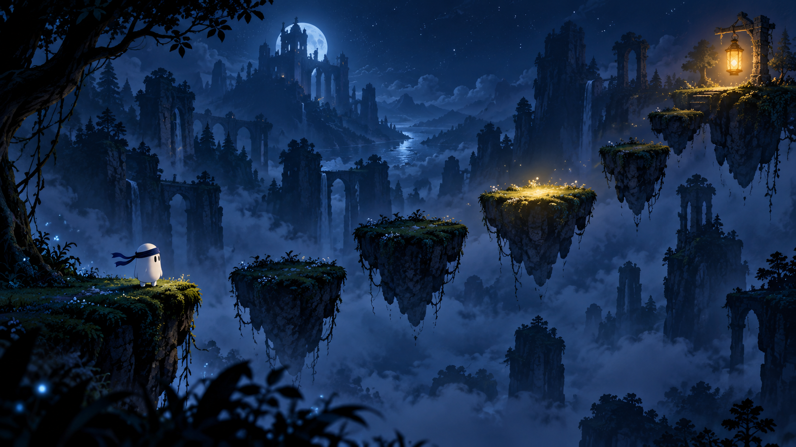
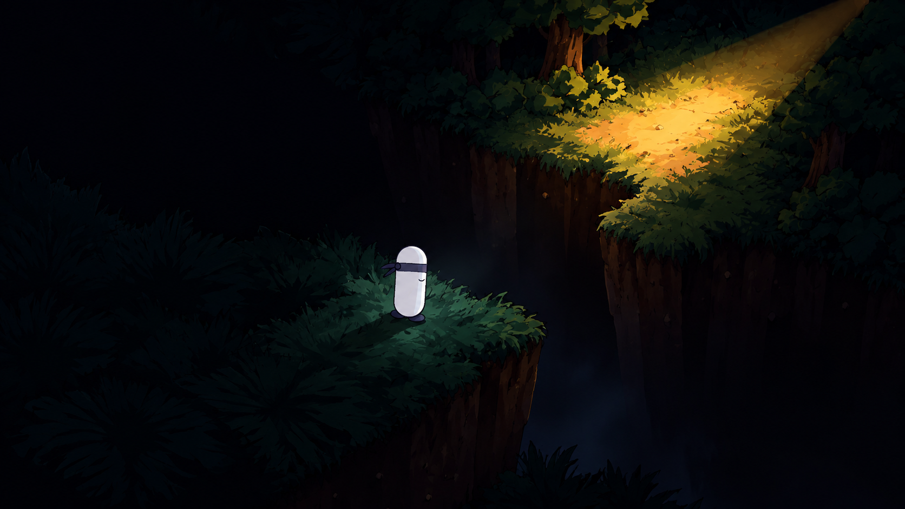
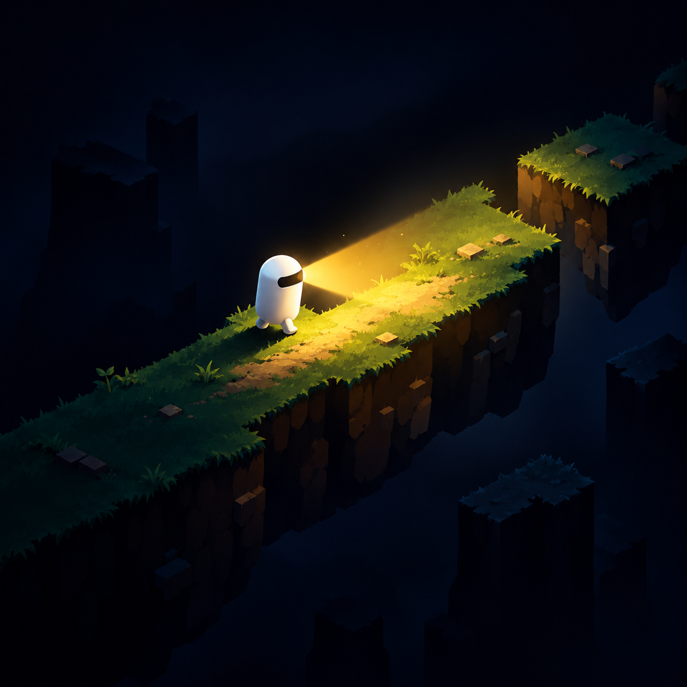

# BlindParkour

**Karanlığın içinden yolunu bul. Bir sonraki platforma ulaş.**

Unity ile geliştirilen, atmosferik bir 2D parkur oyunu.

[⬇️ Windows sürümünü indir](https://github.com/deschamps11/BlindParkour/releases/download/v1.0/BlindParkour.Build.New.rar) · [Tüm sürümler](https://github.com/deschamps11/BlindParkour/releases)

## Oyun hakkında

BlindParkour, karanlık bir dünyada platformlar arasında ilerlemeye odaklanan bir parkur oyunu. Her geçişte mesafeyi ve zamanlamayı gözeterek yoluna devam et.

## Görseller

> Bu bölümdeki resimler oyunun atmosferini yansıtan **tanıtım görselleridir**; oyun içi ekran görüntüsü değildir.

| Karanlıkta bir sonraki adım | Işığa uzanan yol |
| :---: | :---: |
|  |  |

## İndir ve oyna

1. [BlindParkour v1.0 Windows arşivini indir](https://github.com/deschamps11/BlindParkour/releases/download/v1.0/BlindParkour.Build.New.rar).
2. `.rar` dosyasını bir klasöre çıkar.
3. Çıkardığın `BlindParkour Build New` klasöründeki `BlindParkour.exe` dosyasını çalıştır.

`BlindParkour_Data` klasörünü ve diğer oyun dosyalarını `.exe` dosyasıyla aynı yerde tut. Arşivde ayrıca bir oynanış videosu bulunur: `blindparkour gameplay.mp4`.

**Platform:** Windows · **Sürüm:** v1.0 · **Oyun motoru:** Unity

## Geri bildirim

Bir hata bulursan veya önerin varsa [Issues sayfasında](https://github.com/deschamps11/BlindParkour/issues) paylaşabilirsin.
